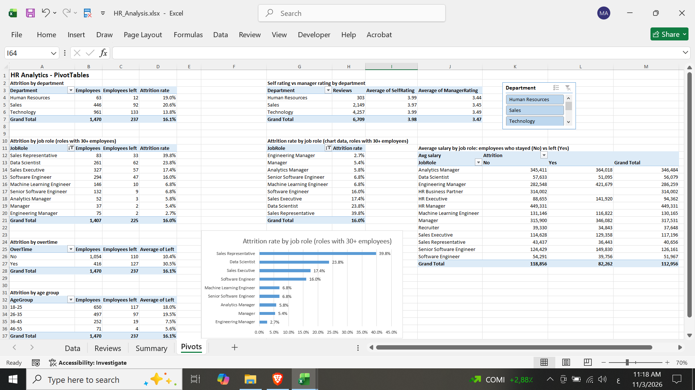
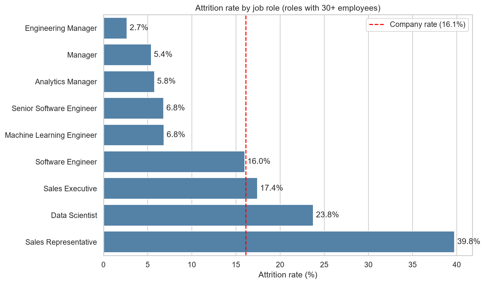
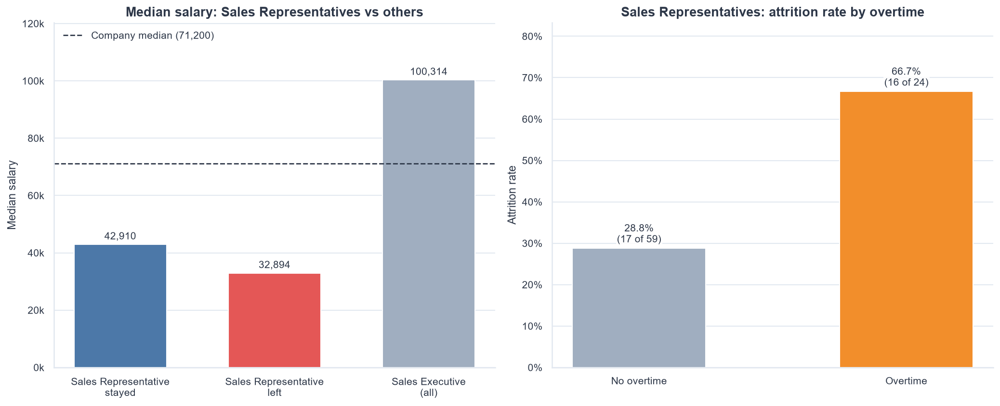
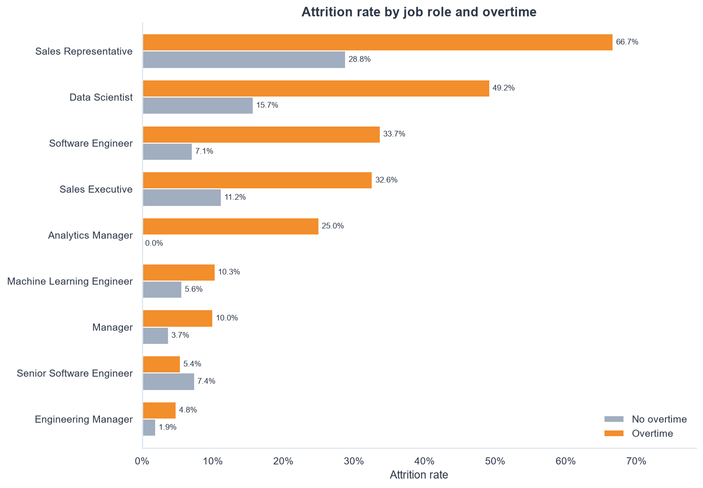
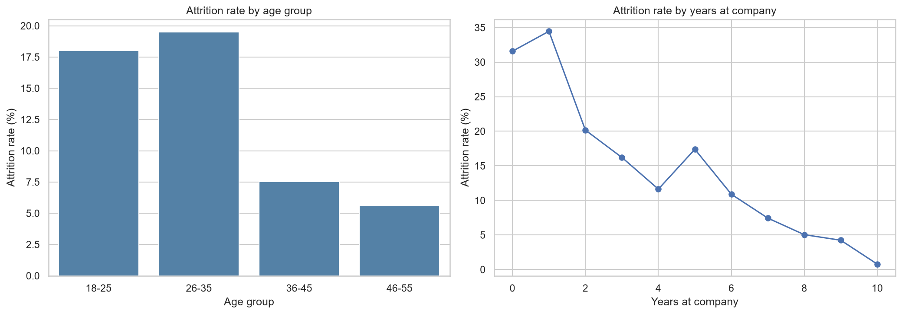
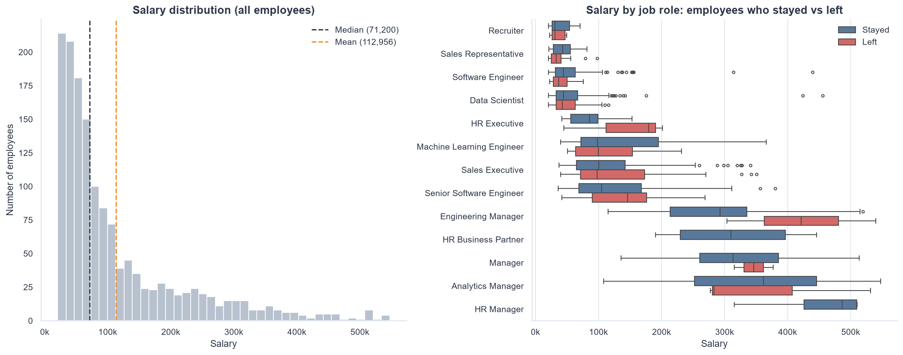
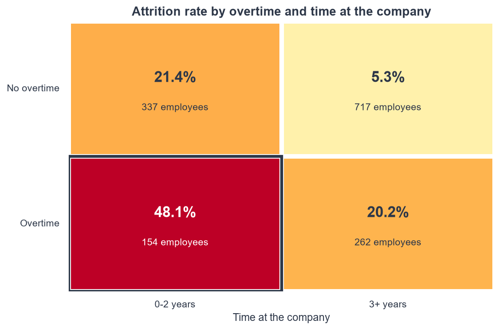

# HR Analytics Project: Employee Attrition & Performance

> **Status:** in progress (SQL, Python, and Excel analysis done; Power BI dashboard next)

## Overview
An end-to-end analysis of HR data for a company with 1,470 employees. The goal is to understand which factors are related to employee attrition (employees leaving the company) and how performance reviews and satisfaction scores look across departments and job roles.

## Business questions
1. What is the overall attrition rate, and how does it differ by department and job role?
2. Is overtime related to attrition, also inside the same job role?
3. Do employees who left earn less than those who stayed, inside the same job role?
4. How do self ratings compare with manager ratings?
5. Are satisfaction, work-life balance, and training related to attrition?

## Dataset
Five CSV files (a practice dataset shared for skill-building; the original source is not documented):

| File | Description | Rows |
|---|---|---|
| Employee.csv | One row per employee: demographics, job, salary, attrition | 1,470 |
| PerformanceRating.csv | Performance reviews and satisfaction scores | 6,709 |
| EducationLevel.csv | Lookup: education level names | 5 |
| RatingLevel.csv | Lookup: rating names | 5 |
| SatisfiedLevel.csv | Lookup: satisfaction level names | 5 |

## Tools
- **Python** (pandas, matplotlib, seaborn) in Jupyter notebooks
- **SQL** (SQLite): joins, CTEs, window functions
- **Excel** (Power Query, formulas, PivotTables, slicer, PivotChart)
- **Power BI** (dashboard): planned
- **Git & GitHub**

## Project structure
```
hr-analytics-project/
├── data/
│   ├── raw/        original CSV files (never edited)
│   └── clean/      cleaned CSV files
├── notebooks/
│   ├── 01_data_cleaning.ipynb
│   ├── 02_create_database.ipynb
│   ├── 03_advanced_sql.ipynb
│   └── 04_eda_analysis.ipynb
├── sql/
│   ├── 01_basic_queries.sql
│   └── 02_advanced_queries.sql
├── excel/
│   └── HR_Analysis.xlsx
├── powerbi/        Power BI report and DAX measures (in progress)
└── images/         charts created by notebook 04
```

## How to run
1. Install the libraries: `pip install pandas matplotlib seaborn ipykernel`
2. Put the 5 CSV files in `data/raw/` and create the folder `data/clean/`.
3. Run the notebooks in order: `01_data_cleaning`, `02_create_database` (creates `data/hr_analytics.db`), `03_advanced_sql`, `04_eda_analysis`.
4. Open `excel/HR_Analysis.xlsx` in Excel (use **Data > Refresh All** only if the CSV paths on your computer are the same).

## Excel workbook
`excel/HR_Analysis.xlsx` was built from the cleaned CSV files in `data/clean`, using Power Query to load and prepare the tables.

| Sheet | Content |
|---|---|
| Data | 1,470 employees (table `EmployeeData`) with formula columns `Left`, `AgeGroup`, and `HireYear`. The education level name is added by merging with the lookup table. |
| Reviews | 6,709 performance reviews (table `ReviewData`) with `Department` and `Attrition` looked up from Data (`INDEX/MATCH`) and `RatingGap` (manager rating minus self rating). |
| Summary | Summary tables built with `COUNTIFS` and `AVERAGEIFS`: attrition by department, job role, overtime, age group, and marital status; salary comparison inside each job role; self rating vs manager rating by department. |
| Pivots | PivotTables for the same questions, a slicer for department, and a chart of attrition rate by job role (roles with 30+ employees). |

Names and ethnicity were removed from the Excel file because they are not needed for the analysis. The average of the `Left` column (1 = left, 0 = stayed) is used as the attrition rate.



## Progress
- [x] Data cleaning (Python)
- [x] SQLite database with primary and foreign keys
- [x] Basic SQL queries
- [x] Advanced SQL queries (HAVING, CTEs, window functions)
- [x] Exploratory analysis and charts (Python)
- [x] Excel workbook (Power Query, formulas, PivotTables, slicer, chart)
- [ ] Power BI dashboard
- [ ] Final insights and recommendations

## Data quality summary
- No missing values and no duplicate rows were found.
- Extra spaces in text columns (BusinessTravel, Ethnicity, EducationField, and the lookup tables) were removed.
- HireDate and ReviewDate were converted from text to dates (stored as `YYYY-MM-DD` text in SQLite).
- Only 1,280 of 1,470 employees have performance reviews, so LEFT JOIN is used to keep all employees.
- Known data issue: 1,141 reviews (17%) for 289 employees are dated before the employee's hire date. These rows are kept and flagged; time-based analysis is done with this in mind.
- Some salaries look unusual for their job role (for example, a Data Scientist at 455,643 when the role median is about 44,000). They are kept because they cannot be confirmed as errors.

## Key findings (so far)
The overall attrition rate is **16.1%** (237 of 1,470 employees). These are relationships in the data, not proven causes.

- **Job role:** Sales Representative has the highest attrition rate (39.8%), followed by Data Scientist (23.8%). Management roles are the lowest (Engineering Manager 2.7%, Manager 5.4%).

  

- **Sales Representatives (deep dive):** 39.8% left (33 of 83). Their median salary is 36,101, compared with 100,314 for Sales Executives and 71,199 for the company. Representatives who left earned less than those who stayed (median 32,894 vs 42,910) and had a shorter time at the company (median 2 vs 4 years). With overtime, 66.7% left (16 of 24), compared with 28.8% (17 of 59) without overtime.

  

- **Overtime:** employees who work overtime left much more often (30.5% vs 10.4%). The gap also appears inside 8 of the 9 job roles with 30+ employees.

  

- **Age and years at company:** attrition is highest in the first two years (about 32-35%) and falls to under 1% at 10 years. Employees aged 18-35 left about 18-20% of the time, compared with 6-8% for ages 36-55.

  

- **Salary:** employees who left earned less on average overall, but inside the same job role the gap goes in both directions (lower in 4 roles, higher in 5 roles). The overall gap is partly explained by which roles employees left from.

  

- **High-risk segment:** employees who work overtime and have 0-2 years at the company are 154 people (10.5% of employees). Their attrition rate is 48.1%, and they account for 31% of all employees who left. The lowest-risk group (no overtime, 3+ years) has an attrition rate of 5.3%.

  

- **Promotion:** attrition falls as years since the last promotion increase, but this is closely linked to years at the company (correlation 0.87), so it mostly reflects tenure.

- **Ratings:** managers rated lower than the employee's self rating in 51% of reviews (average 3.47 vs 3.98) and higher in only 1 of 6,709.

- **Satisfaction:** satisfaction and work-life balance scores are almost the same for employees who left and who stayed.

- **Other factors:** single employees (23.3%), frequent travellers (24.9%), and employees with no stock options (24.4%) have higher attrition rates.

## Limitations
- The findings show relationships, not causes. Factors such as age, tenure, role, and overtime overlap, and the charts do not separate them.
- Some groups are small (for example Analytics Manager and the HR roles), so their rates are less reliable.
- Satisfaction scores exist only for employees with reviews (1,280 of 1,470).
- The review-date issue above limits analysis over time.
- There are no commission or sales target columns, and it is not known whether `Salary` includes commission. For Sales Representatives, this means the analysis cannot test whether low target achievement explains why they leave.

## Preliminary recommendations (to be tested)
- **Sales Representatives:** review base pay and overtime for this role. Their median salary is far below Sales Executives, and attrition is much higher with overtime (66.7%).
- **Early-tenure support:** focus onboarding and retention on the first two years, when most employees leave (29.7% for 0-2 years).
- **Overtime in the high-risk segment:** employees with overtime and 0-2 years have a 48.1% attrition rate. Monitor this group as a KPI.
- **Data request:** ask the data owner for commission and sales target achievement for Sales Representatives, and confirm whether `Salary` includes commission. If commission is part of pay, compare target achievement and commission between employees who left and who stayed. This would show if the problem is the targets, the commission rate, or both.
- Check the unusual salary values with the data owner before using salary averages in decisions.

## Suggested KPIs for monitoring
| KPI | Current value |
|---|---|
| Company attrition rate | 16.1% |
| Attrition rate in the first 2 years | 29.7% |
| Overtime attrition gap | 20.1 percentage points |
| High-risk segment (overtime and 0-2 years): employees | 154 |
| High-risk segment: attrition rate | 48.1% |
| Sales Representative attrition rate | 39.8% |

## Next steps
- Power BI dashboard (overview page and attrition page).
- Final insights and recommendations.
